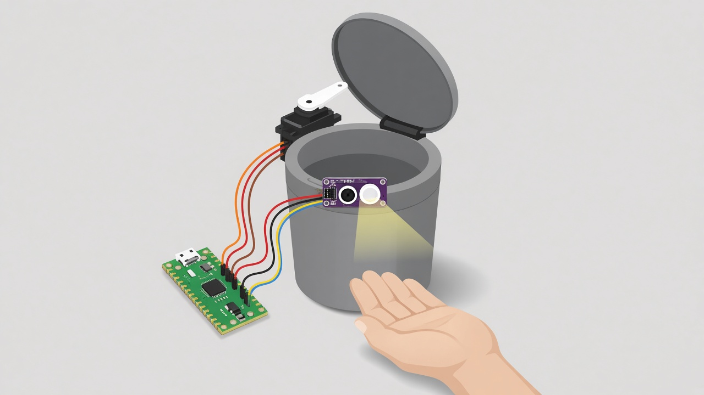

# garbagecan

A Raspberry Pi Pico opens a bin lid when a hand comes close. A VL53L0X distance sensor watches the front of the can. If something is about 12 cm away or closer, the Pico turns an A0090 9g micro servo 90 degrees anticlockwise and the lid opens. One second after the space is clear, the servo returns and the lid closes.

The Pico is the green board. The purple board on the rim is the VL53L0X. The black servo at the hinge lifts the lid.

## Wiring

Hold the Pico with the USB port at the top.

| Part | Wire | Pico pin |
|---|---|---|
| VL53L0X | SDA | GP0 (pin 1, top left) |
| VL53L0X | SCL | GP1 (pin 2) |
| VL53L0X | VIN | 3V3 (pin 36) |
| VL53L0X | GND | GND |
| Servo | White or orange (signal) | GP2 (pin 4) |
| Servo | Red (5 V) | VBUS (pin 40, top right) |
| Servo | Black or brown (ground) | GND |

Leave the sensor’s XSHUT and GPIO1 pins unconnected. `main.py` runs on its own when the Pico powers up.
